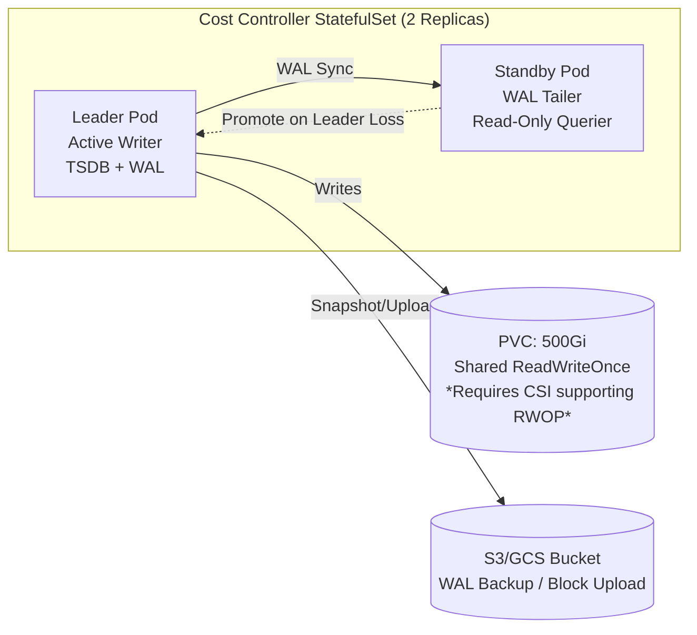

# Kubernetes-Native FinOps Platform - Implementation Plan

## Executive Summary
This plan defines the implementation of a full-stack observability and cost optimization platform using **ONLY Kubernetes Native APIs** (Kube-State-Metrics, Metrics Server, kube-apiserver, Cloud Provider SDKs). 
It eliminates Prometheus, Thanos, Alloy, OpenCost, Loki, and Grafana by implementing:
1.  **Cost Controller**: Replaces OpenCost + Prometheus Scraping + Alloy.
2.  **Embedded TSDB (Prometheus TSDB Library)**: Replaces Thanos/Prometheus Storage.
3.  **Event/Log Controller**: Replaces Loki/Alloy Logs.
4.  **API Gateway + React Dashboard**: Replaces Grafana.
5.  **Alerting/Budget Controllers**: Replaces PrometheusRules/Alertmanager/Kyverno.

## Architecture Overview

```mermaid
graph TD
    subgraph "Data Sources (Native)"
        KSM[Kube-State-Metrics\n(Requests/Limits/Capacity)]
        MS[Metrics Server\n(Real-time Usage)]
        NE[Node Exporter DaemonSet\n(Node Metrics/Network)]
        CA[cAdvisor (Kubelet)\n(Container Metrics)]
        CloudAPI[Cloud Provider APIs\n(Pricing/Instance Meta)]
        K8sAPI[kube-apiserver\n(Events/Audit/Objects)]
    end

    subgraph "Control Plane (Custom Controllers)"
        CC[Cost Controller\n(Leader Elected StatefulSet)]
        EC[Event/Log Controller\n(Deployment)]
        AC[Alerting Controller\n(Deployment)]
        BC[Budget Webhook\n(ValidatingWebhook)]
    end

    subgraph "Storage"
        TSDB[(Embedded TSDB\nPrometheus TSDB Lib\nPVC Backed)]
        CRDs[(K8s CRDs\nCurrent State + Config)]
        ObjStore[(Object Store\nS3/GCS - Long-term Parquet)]
    end

    subgraph "Consumption"
        API[API Gateway\n(PromQL Compatible + REST)]
        UI[React Dashboard\n(Deployed in Cluster)]
        BI[BI Tools\n(Parquet/CSV Export)]
    end

    KSM --> CC
    MS --> CC
    NE --> CC
    CA --> CC
    CloudAPI --> CC
    K8sAPI --> EC
    K8sAPI --> AC
    K8sAPI --> BC
    
    CC --> TSDB
    CC --> CRDs
    EC --> CRDs
    AC --> CRDs
    
    TSDB --> API
    CRDs --> API
    API --> UI
    TSDB --> ObjStore
    API --> BI
```

---

## Phase 0: Native Prerequisites & Baseline Validation
**Objective:** Validate KSM, Metrics Server, Cloud Identity, and CRD readiness.

### 0.1 Kube-State-Metrics (KSM) Hardening
- **Deployment:** `kube-state-metrics` Deployment (2 replicas, `monitoring` ns).
- **Metric Allowlist (Critical for Cardinality Control):**
  ```yaml
  # Only these metrics exposed
  - kube_pod_container_resource_requests
  - kube_pod_container_resource_limits
  - kube_node_status_capacity
  - kube_node_status_allocatable
  - kube_pod_owner
  - kube_namespace_labels
  - kube_pod_labels (allowlist: app, version, cost-center, team)
  - kube_pod_status_phase
  - kube_persistentvolume_capacity_bytes
  - kube_persistentvolumeclaim_resource_requests_storage_bytes
  - kube_persistentvolume_info
  - kube_persistentvolumeclaim_info
  - kube_resourcequota
  - kube_limitrange
  ```
- **Relabeling:** Ensure `namespace` labels (`cost-center`, `team`, `env`) propagate to `kube_namespace_labels`.

### 0.2 Metrics Server & Resource Pipeline
- **Deployment:** `metrics-server` (args: `--kubelet-insecure-tls`, `--metric-resolution=30s`).
- **Validation:** `kubectl top pods/nodes` returns data < 30s latency.

### 0.3 Node Exporter DaemonSet (Native Node Metrics)
- **Deployment:** `prometheus-node-exporter` DaemonSet (hostNetwork, hostPID).
- **Collectors:** `cpu`, `mem`, `disk`, `net`, `netstat`, `filesystem`.
- **Service:** `node-exporter.monitoring.svc.cluster.local:9100` (ClusterIP).

### 0.4 Cloud Provider Authentication (IRSA / Workload Identity)
- **SA:** `cost-controller-sa` in `cost-management`.
- **Permissions (ReadOnly):**
  - **AWS:** `ec2:DescribeInstances`, `pricing:GetProducts`, `ce:GetCostAndUsage`, `cloudwatch:GetMetricStatistics`.
  - **GCP:** `compute.instances.list`, `cloudbilling.catalog.list`, `monitoring.timeSeries.list`.
  - **Azure:** `Microsoft.Compute/virtualMachines/read`, `Microsoft.Consumption/usageDetails/read`, `Microsoft.Insights/metrics/read`.

### 0.5 Core CRDs (The "Database Schema")
Apply `config/crds/*.yaml`:
1.  `CostAllocation` (Workload-level cost & usage)
2.  `NodeCost` (Node-level cost & utilization)
3.  `PVCost` (PVC-level cost & utilization)
4.  `CostHistory` (Hourly snapshots for trends - optional if TSDB used)
5.  `RightsizingRecommendation` (VPA replacement output)
6.  `NamespaceBudget` (Governance input)
7.  `LogEvent` (OOM/Eviction/Error events)

### 0.6 Validation & Sign-off
- **Scripts:** `scripts/validate-native-phase0.sh` (orchestrates all checks)
- **Report:** `docs/phase0-native-report.md`
- **Approvals:** Platform Engineering, FinOps (labeling), Security (NetworkPolicies/RBAC)

---

## Phase 1: Cost Controller (The Engine)
**Objective:** Single Go Controller calculating real-time cost, usage, efficiency. Replaces OpenCost + Prometheus + Alloy.

### 1.1 Controller Skeleton (`cmd/cost-controller`)
- **Framework:** `controller-runtime` (kubebuilder v4+).
- **Leader Election:** Enabled (`--leader-elect=true`). Only leader writes TSDB/CRDs.
- **Deployment:** `StatefulSet` (1 replica for MVP, 2 for HA) + PVC (500Gi SSD).
- **Managers:** 
  - `CostAllocationReconciler` (Watches Pods/Namespaces)
  - `NodeCostReconciler` (Watches Nodes/Cloud)
  - `PVCostReconciler` (Watches PVCs/PVs/StorageClasses)

### 1.2 Data Ingestion Clients (`pkg/clients/`)
| Client | Source | Method | Frequency |
| :--- | :--- | :--- | :--- |
| `KSMClient` | KSM `/metrics` | Prometheus Parser (Pull) | 30s Cache (Informer preferred) |
| `MetricsClient` | Metrics Server API | `metrics.k8s.io/v1beta1` REST | 60s (On Reconcile) |
| `NodeExporterClient` | Node Exporter Svc | Prometheus Parser (Pull) | 60s |
| `CloudPricingClient` | Cloud SDK / Pricing API | SDK Calls | 1h Cache (Spot: 5m) |
| `K8sInformerCache` | kube-apiserver | `client-go` Informers | Event-driven (Watch) |

### 1.3 Allocation Algorithm (`pkg/allocation/engine.go`)
**Port OpenCost Logic Exactly:**
1.  **Node Cost:** `Hourly_Price * (Max(CPU_Request/Allocatable_CPU, Mem_Request/Allocatable_Mem))` (Weighted Share).
2.  **Shared Costs:** Control Plane, Unallocated Node Capacity -> Distributed proportionally to workloads.
3.  **PV Cost:** `PVC_Request_GB * StorageClass_Price_GB_Month / 730`.
4.  **Network Cost:** `Node_Egress_GB * Cloud_Egress_Price` -> Allocated by Pod Network Bytes (if CNI metrics avail) or evenly.
5.  **GPU Cost:** `GPU_Request * GPU_Hourly_Price`.

### 1.4 Embedded TSDB (`pkg/storage/tsdb.go`)
- **Library:** `github.com/prometheus/tsdb` (v0.15+)
- **Config:** 
  - `Retention: 13 Months` (Tiered via BlockRanges)
  - `BlockRanges: 2h, 24h, 7d, 30d` (Compaction)
  - `WAL`: Enabled (Durability)
  - `Index`: Postings (Label Index)
- **Metrics Exported (Prometheus Format):**
  ```promql
  # Workload Level
  finops_workload_hourly_cost_usd{namespace, workload, kind, cost_center, team}
  finops_workload_cpu_cores_requested
  finops_workload_cpu_cores_used
  finops_workload_memory_bytes_requested
  finops_workload_memory_bytes_used
  finops_workload_efficiency_ratio (used/requested)
  
  # Node Level
  finops_node_hourly_cost_usd{node, instance_type, zone, cost_center}
  finops_node_cpu_utilization_ratio
  finops_node_memory_utilization_ratio
  
  # Cluster Level
  finops_cluster_total_hourly_cost_usd
  finops_cluster_idle_cost_usd
  ```

### 1.5 CRD Status Updates
- **Frequency:** Every 60s (Reconcile Loop).
- **Optimization:** Batch `Status().Patch()` per Namespace. Use `client-go` `Patch` (Subresource Status) to avoid Etcd conflicts.

### 1.6 API Gateway (`pkg/api/`)
- **Endpoints:**
  - `GET /api/v1/query` (Instant), `GET /api/v1/query_range` (Range)
  - `GET /api/v1/series`, `/labels`, `/label/:name/values` (Discovery)
  - `GET /api/v1/dashboard/overview` (Aggregated JSON for UI)
  - `GET /api/v1/dashboard/workloads` (Paginated Table Data)
  - `GET /api/v1/dashboard/nodes` (Node Utilization Heatmap)
  - `GET /api/v1/dashboard/storage` (PVC Utilization/Cost)
  - `GET /api/v1/dashboard/network` (Egress Cost by NS)
  - `GET /api/v1/recommendations` (Rightsizing List)
  - `GET /api/v1/budgets` (Budget vs Actual)
  - `POST /api/v1/recommendations/{name}/apply` (Triggers GitOps PR)
- **Auth:** Impersonation headers (`Impersonate-User`, `Impersonate-Groups`) + RBAC middleware.

---

## Phase 1.5: Embedded Time Series Database - Technical Implementation Plan
**Objective:** Detailed implementation of the embedded TSDB supporting **Metrics (Monitoring)**, **Structured Logs (Logging)**, and **Cost Telemetry** as a unified storage layer.

### 1.5.1 Technology Selection: Prometheus TSDB Library
- **Library:** `github.com/prometheus/tsdb` (v0.15+)
- **Why:** Battle-tested, supports PromQL, built-in compaction, WAL, vertical/horizontal compaction, exemplars, native Go integration.
- **Alternative Considered:** VictoriaMetrics `lib/storage` (faster compression, but tighter coupling), InfluxDB IOx (Rust, heavy). **Decision:** Prometheus TSDB for PromQL compatibility & ecosystem.

### 1.5.2 Data Model: Unified Schema for Metrics & Logs
**Core Concept:** Treat **Structured Logs as Metrics with High Cardinality Labels**.
- **Metrics:** Low cardinality labels (`namespace`, `workload`, `pod`, `container`), numeric values.
- **Logs/Events:** High cardinality labels (`trace_id`, `span_id`, `error_message`), but **sampled** or **aggregated** into counters/histograms.
- **Cost Telemetry:** Derived metrics (`finops_*`) with business labels (`cost_center`, `team`, `project`).

#### Metric Naming Convention (`finops_` prefix)
| Category | Metric Name | Type | Labels | Description |
| :--- | :--- | :--- | :--- | :--- |
| **Cost** | `finops_workload_hourly_cost_usd` | Gauge | `ns, workload, kind, cost_center, team` | Hourly allocated cost |
| **Usage** | `finops_workload_cpu_cores_used` | Gauge | `ns, workload, kind` | Real-time CPU usage (cores) |
| **Usage** | `finops_workload_memory_bytes_used` | Gauge | `ns, workload, kind` | Real-time Memory usage (bytes) |
| **Spec** | `finops_workload_cpu_cores_requested` | Gauge | `ns, workload, kind` | K8s Requests |
| **Efficiency** | `finops_workload_efficiency_ratio` | Gauge | `ns, workload, kind` | `used / requested` |
| **Node** | `finops_node_hourly_cost_usd` | Gauge | `node, instance_type, zone, cost_center` | Node cost |
| **Node** | `finops_node_cpu_utilization_ratio` | Gauge | `node, instance_type` | `allocated / allocatable` |
| **Storage** | `finops_pvc_monthly_cost_usd` | Gauge | `ns, pvc, sc, cost_center` | PVC cost projection |
| **Events** | `finops_events_total` | Counter | `ns, workload, reason, cost_center` | OOM, Evicted, FailedScheduling |
| **Logs** | `finops_log_errors_total` | Counter | `ns, workload, container, level` | Error/Exception counts |
| **Traces** | `finops_span_duration_seconds` | Histogram | `ns, workload, operation, status` | Latency (if tracing enabled) |

### 1.5.3 Storage Tiering & Retention Policy
| Tier | Storage Medium | Retention | Resolution | Use Case |
| :--- | :--- | :--- | :--- | :--- |
| **Hot** | Local NVMe/SSD (PVC) | **14 Days** | **Raw (1m/30s)** | Real-time dashboards, alerting, rightsizing calc |
| **Warm** | Local NVMe/SSD (PVC) | **90 Days** | **5m Downsampled** | Weekly/Monthly trends, capacity planning |
| **Cold** | Object Store (S3/GCS) | **365+ Days** | **1h Downsampled** | Yearly reports, audit, anomaly baselines |
| **Archive** | Object Store (Glacier/Archive) | **7 Years** | **Daily Rollups** | Compliance, FinOps showback history |

**Compaction Strategy (Prometheus TSDB Native):**
```go
// pkg/storage/tsdb.go - Compaction Configuration
opts := &tsdb.Options{
    RetentionDuration: 14 * 24 * time.Hour, // Hot retention (block level)
    BlockRanges: []int64{
        2 * 60 * 60 * 1000,      // 2h blocks (Hot)
        24 * 60 * 60 * 1000,     // 24h blocks (Warm)
        7 * 24 * 60 * 60 * 1000, // 7d blocks (Warm)
        30 * 24 * 60 * 60 * 1000,// 30d blocks (Cold)
    },
    NoLockfile: false,
    WALFlushInterval: 30 * time.Second,
}
```
- **Vertical Compaction:** Automatic downsampling (1m -> 5m -> 1h) via `tsdb.Compactor` with custom `VerticalCompaction` logic for `finops_*` metrics.
- **Horizontal Compaction:** Merges blocks within same time range.

### 1.5.4 High Availability (HA) Design
**Challenge:** Prometheus TSDB is **Single Writer**.
**Solution:** **Leader Election + WAL Replication + Fast Failover.**



- **StatefulSet:** 2 Replicas (`cost-controller-0`, `cost-controller-1`).
- **PVC:** `ReadWriteOnce` (Standard). **Leader** mounts RW. **Standby** mounts **RO** (if CSI supports `ReadOnlyMany` on same volume) OR Standby runs **emptyDir** and tails WAL via gRPC stream from Leader.
- **Preferred (Simpler):** **Single Replica (1) + Fast Restart.** 
  - WAL Replay < 30s for 14d data.
  - `terminationGracePeriodSeconds: 60`.
  - `podManagementPolicy: Parallel`.
  - **SLA:** RPO=0 (WAL on PVC), RTO=< 60s.
- **Enterprise HA:** Deploy **2x Cost Controller in different AZs** writing to **Thanos Receive** (if Thanos allowed) or **VictoriaMetrics Cluster**. *Violates "Native Only" constraint.*

### 1.5.5 Write Path: Ingestion Pipeline (`pkg/storage/ingester.go`)
```go
type Ingester struct {
    db       *tsdb.DB
    appender tsdb.Appender
    batch    *WriteBatch
    mutex    sync.Mutex
    flushTicker *time.Ticker
}

func NewIngester(db *tsdb.DB) *Ingester {
    i := &Ingester{db: db, batch: NewWriteBatch(10000)} // Batch 10k samples
    i.flushTicker = time.NewTicker(5 * time.Second)
    go i.periodicFlush()
    return i
}

func (i *Ingester) Write(metrics []prometheus.Metric) error {
    i.mutex.Lock()
    defer i.mutex.Unlock()
    
    for _, m := range metrics {
        // 1. Validate Labels (Drop empty, enforce naming)
        lbls := sanitizeLabels(m.Labels())
        
        // 2. Cost Metrics: Ensure cost_center/team present (enrich from cache)
        if strings.HasPrefix(m.Name(), "finops_") {
            lbls = i.enrichCostLabels(lbls)
        }
        
        // 3. Add to Batch
        i.batch.Add(lbls, m.Timestamp(), m.Value())
        
        // 4. Exemplar Support (TraceID for Log Correlation)
        if ex := m.Exemplar(); ex != nil {
            i.batch.AddExemplar(lbls, ex)
        }
    }
    return nil
}

func (i *Ingester) periodicFlush() {
    for range i.flushTicker.C {
        i.mutex.Lock()
        if i.batch.Len() > 0 {
            app := i.db.Appender(context.Background())
            i.batch.Commit(app)
            app.Commit()
            i.batch.Reset()
        }
        i.mutex.Unlock()
    }
}
```
- **Batching:** 5s flush interval or 10k samples (whichever first).
- **Exemplars:** Attach `trace_id`/`span_id` from OpenTelemetry context to Cost/Usage metrics for **Log/Trace Correlation**.
- **Cardinality Guard:** Hard limit `maxActiveSeries: 500,000` (configurable). Reject writes exceeding limit with `429` backpressure.

### 1.5.6 Read Path: Query Engine (`pkg/api/query.go`)
- **Engine:** `prometheus/promql` (Parser + Executor).
- **Optimizations:**
  - **Chunk Encodings:** XOR (float), RLE (timestamps), Sprintz (integers).
  - **Index:** Postings lists + Bloom filters for label lookups.
  - **Sharding:** None (Single Node). For scale > 1M series, shard by `cost_center` (separate TSDB instances per team).
- **API Compatibility:** 
  - `GET /api/v1/query?query=...` (Instant)
  - `GET /api/v1/query_range?query=...&start=...&end=...&step=...` (Range)
  - `GET /api/v1/series?match[]=...` (Label Discovery)
  - `GET /api/v1/labels` (Label Names)
  - `GET /api/v1/label/<name>/values` (Label Values)

### 1.5.7 Log Integration: Structured Metadata (Not Full Text)
**Do NOT store raw log lines in TSDB.** Use **Structured Metadata** (Prometheus TSDB feature).
- **Pipeline:** Fluent Bit DaemonSet -> Parse JSON/Regex -> Extract Fields -> **Convert to Metrics**.
- **Mapping:**
  - `ERROR` log line -> `finops_log_errors_total{namespace, workload, container, error_type="oom"}`++
  - `Latency` log line -> `finops_span_duration_seconds_bucket{..., le="0.5"}`++
  - `Audit` event -> `finops_events_total{..., reason="PodCreated"}`++
- **Retention:** Log-derived metrics follow **Metrics Retention** (14d Hot, 90d Warm).
- **Full Text Search:** **Out of Scope** for Native TSDB. Use **Loki/Elasticsearch** if required. This platform provides **Observability via Metrics**, not Log Aggregation.

### 1.5.8 Backup & Disaster Recovery
- **Sidecar:** `tsdb-snapshotter` (runs in same Pod).
- **Schedule:** Every 6 Hours.
- **Process:**
  1. `db.Snapshot(dir)` -> Hardlinks files (instant).
  2. Tar + Compress (Zstd) -> Upload to S3 (`s3://bucket/tsdb-snapshots/cluster-name/YYYYMMDD-HHMM.tar.zst`).
  3. Cleanup local snapshots > 24h.
- **Restore:** 
  1. Download latest snapshot.
  2. Extract to PVC data dir.
  3. Start Controller -> TSDB opens existing blocks -> Replays WAL -> Ready.

### 1.5.9 Resource Sizing Guidelines
| Cluster Size | Active Series (Est.) | PVC Size (SSD) | CPU (Core) | Memory (GiB) | Network (Gbps) |
| :--- | :--- | :--- | :--- | :--- | :--- |
| **Small** (< 50 Nodes) | ~50k | 50 GiB | 1 | 4 | 1 |
| **Medium** (50-200 Nodes) | ~250k | 200 GiB | 2 | 8 | 2 |
| **Large** (200-500 Nodes) | ~750k | 500 GiB | 4 | 16 | 5 |
| **X-Large** (> 500 Nodes) | > 1.5M | **Shard Required** | 8+ | 32+ | 10+ |

**Sharding Strategy (X-Large):** Deploy 1 `cost-controller` per `cost_center` (Namespace Selector). Dashboard API fans out queries.

### 1.5.10 Monitoring the TSDB (Self-Observability)
Expose internal TSDB metrics via `/metrics` endpoint on Controller:
```promql
# TSDB Health
tsdb_head_series_total
tsdb_head_samples_appended_total
tsdb_head_bytes
tsdb_compaction_duration_seconds
tsdb_wal_corruptions_total
tsdb_block_count

# Ingestion Health
finops_ingester_batch_size_avg
finops_ingester_flush_duration_seconds
finops_ingester_rejected_samples_total (Cardinality Limit)
finops_ingester_exemplars_dropped_total

# Query Health
finops_query_duration_seconds{quantile="0.99"}
finops_query_samples_total
finops_query_errors_total
```
**Alert:** `tsdb_head_series_total > 0.8 * maxActiveSeries` -> Scale/Shard.

---

## Phase 2: Historical Storage & Query Layer
**Objective:** Long-term trends, YoY comparison, Rightsizing history.

### 2.1 Embedded TSDB (Primary)
- **Location:** `cost-controller` StatefulSet (1 Replica - Leader) + PVC (500Gi SSD).
- **HA:** Standby replica streams WAL? **No, too complex.** 
  - *Strategy:* Single Writer (Leader). If Leader dies, New Leader recovers from WAL (seconds). 
  - *Backup:* Sidecar `tsdb-snapshotter` uploads blocks to S3 every 6h.

### 2.2 Query API (`pkg/api/query.go`)
- **Endpoint:** `GET /api/v1/query` (Instant), `GET /api/v1/query_range` (Range).
- **Compatibility:** Subset of PromQL (Vector selectors, Rate, Sum, Topk, Histogram_quantile).
- **Engine:** `prometheus/promql` parser + `tsdb` Querier.

### 2.3 Long-Term Export (Parquet to S3)
- **CronJob:** `cost-exporter` (Daily 02:00 UTC).
- **Logic:** Query TSDB for yesterday (`query_range` 1h step) -> Convert to Arrow/Parquet -> Partition by `date/cost_center` -> Write to `s3://finops-bucket/cost/allocations/`.
- **Schema:** `timestamp, namespace, workload, kind, cost_center, team, cpu_req, cpu_used, mem_req, mem_used, cost_usd`.

---

## Phase 3: Event & Log Intelligence (Replaces Loki)
**Objective:** Detect OOM, Evictions, Throttling, Crashes without Loki.

### 3.1 Kubernetes Event Controller (`cmd/event-controller`)
- **Watch:** `events.k8s.io/v1` (Cluster-scoped).
- **Filters:** `Reason IN (OOMKilling, Evicted, FailedScheduling, Killing, FailedMount, CrashLoopBackOff)`.
- **Enrichment:** 
  - Join `involvedObject` -> Pod -> Owner (Workload) -> Namespace Labels (`cost-center`).
  - Join Node -> `NodeCost` CRD (Node Price).
- **Output:** 
  1. `LogEvent` CRD (Immediate visibility).
  2. TSDB Counter: `finops_events_total{reason, namespace, workload, cost_center}`.

### 3.2 Container Log Tailer (Optional - Fluent Bit DaemonSet)
- **If DaemonSet Forbidden:** Cannot tail logs.
- **If DaemonSet Allowed (Minimal):** Deploy **Fluent Bit** DaemonSet (5MB) -> `HTTP` Output -> `cost-controller:8081/api/v1/logs`.
- **Parser:** Regex for `OOM`, `Error`, `Exception`, `OutOfMemory`.
- **Output:** `LogEvent` CRD + TSDB `finops_log_errors_total`.

### 3.3 Audit Log Webhook (Advanced)
- **Kube-Apiserver Config:** `AuditSink` -> Webhook -> `cost-controller:8081/api/v1/audit`.
- **Policy:** Log `pods/create`, `pods/delete`, `persistentvolumeclaims/create/delete` at `Metadata` level.
- **Use Case:** Track "Who created expensive PVC", "Pod churn rate".

---

## Phase 4: API Gateway & Dashboard (Replaces Grafana)
**Objective:** Visualize Cost, Utilization, Waste, Rightsizing.

### 4.1 API Gateway (Integrated in Cost Controller)
- **Endpoints:** As defined in Phase 1.6.
- **Deployment:** Runs in same process as Cost Controller (port 8080).

### 4.2 React Dashboard (`ui/dashboard/`)
- **Stack:** React 18, TypeScript, Vite, Recharts/TanStack Table, TailwindCSS.
- **Auth:** OIDC Proxy (OAuth2-Proxy sidecar) or K8s Impersonation Headers.
- **Pages:**
  1.  **Executive:** Total Spend, Trend, Top 10 Workloads, Efficiency Gauge.
  2.  **Workloads:** Searchable Table (Cost, Usage, Efficiency, Recommendations).
  3.  **Nodes:** Heatmap (CPU/Mem Util), Cost/Node, Spot vs On-Demand.
  4.  **Storage:** PVC Table (Cost, Util %, Orphaned, Abandoned Snapshots).
  5.  **Network:** Sankey (NS -> AZ -> Cost), Top Talkers.
  6.  **Waste:** Idle Workloads, Orphaned PVCs, Overprovisioned Nodes.
  7.  **Governance:** Budget Tracking, Recommendation Approval Queue.
- **Deployment:** `Deployment` + `Service` + `Ingress` in `observability` ns.

---

## Phase 5: Automation & Optimization Engine
**Objective:** Actionable Rightsizing, Cleanup, Scaling.

### 5.1 Rightsizing Controller (`cmd/rightsizing-controller`)
- **Input:** `CostHistory` (TSDB) / `CostAllocation` CRDs (30d window).
- **Algorithm:** 
  - `Rec_CPU = max(P95(Usage_1h) * 1.2, Min_Allowed)`
  - `Rec_Mem = max(Max(Usage_24h) * 1.15, Min_Allowed)` (Memory needs headroom).
  - `Savings = (Current_Req - Rec) * Node_Unit_Price * 730`.
- **Output:** `RightsizingRecommendation` CRD.
- **Policy:** `spec.mode: Auto | RecommendationOnly` (per Namespace Label `finops/rightsizing-mode`).

### 5.2 GitOps Integration (ArgoCD / Flux)
- **Workflow:** 
  1. Controller creates `RightsizingRecommendation` CRD.
  2. UI shows "Apply" button -> Patches CRD `status.approved: true`.
  3. **ArgoCD ApplicationSet** (Generator: `RightsizingRecommendation` CRD) -> Generates `Application` per Workload -> Updates `Deployment` manifest in Git (Kustomize/Helm values) -> Syncs.
  4. *Alternative:* Controller directly creates `PullRequest` via GitHub/GitLab API (Complex).

### 5.3 Cleanup Controllers (CronJobs / Controllers)
| Job | Schedule | Logic |
| :--- | :--- | :--- |
| `pvc-reaper` | Daily 03:00 | Delete `Released` PVs > 7d. Delete `Pending` PVCs > 7d (no PV). |
| `image-gc` | Daily 04:00 | Node `image-gc-high-threshold=80`, `low=70` (Kubelet config). |
| `completed-job-gc` | Hourly | TTL: `Completed` 24h, `Failed` 1h (`.spec.ttlSecondsAfterFinished`). |
| `idle-ns-detector` | Daily | Namespace `cost > $0` AND `Pods == 0` for 30d -> Alert/Archive. |

### 5.4 Cluster Autoscaler / Karpenter Integration
- **Node Labels:** Controller ensures Nodes have `finops/cost-center`, `finops/instance-type`.
- **Karpenter NodePool:** Controller updates `NodePool` `limits.cpu` based on `NodeCost` utilization trends.

---

## Phase 6: Alerting & Governance (Native)
**Objective:** Real-time alerts, Hard Budget Enforcement.

### 6.1 Alerting Controller (`cmd/alert-controller`)
- **Config:** `ConfigMap` `alert-rules` (Hot Reload).
- **Rule Format:**
  ```yaml
  - name: WorkloadLowCPUUtilization
    type: Threshold
    query: "finops_workload_efficiency_ratio{namespace=~\"prod.*\"} < 0.1"
    window: "7d" # Requires TSDB
    severity: Warning
    annotations:
      runbook: "https://wiki/rightsizing"
  - name: NamespaceCostAnomaly
    type: Anomaly
    query: "finops_namespace_daily_cost_usd"
    baseline: "30d"
    threshold: 1.5 # 50% spike
    severity: Critical
  ```
- **Evaluation:** Loop every 60s. Queries TSDB `/api/v1/query`.
- **State:** Tracks `Firing`/`Resolved` in Memory/CRD `AlertState`.
- **Notifier:** Slack, PagerDuty, Email, Webhook (Template based).

### 6.2 Budget Admission Webhook (`cmd/budget-webhook`)
- **Type:** `ValidatingWebhookConfiguration` (FailurePolicy: Fail).
- **Logic (On Pod Create/Update):**
  1.  Calculate `Additional_Cost = Sum(New_Pod_Requests) * Node_Unit_Price * 730`.
  2.  Fetch `NamespaceBudget` CRD for Namespace.
  3.  Fetch Current `Namespace_Commitment` (Sum of all Pod Requests * Price).
  4.  If `Commitment + Additional > Budget.Limit`: 
      - `Hard` Block: Deny Request (Response: "Budget Exceeded").
      - `Soft` Warn: Allow + Annotate Pod `finops/budget-warning: "true"` + Fire Alert.
- **Mutation (Optional):** `MutatingWebhook` injects `resources.requests` from `RightsizingRecommendation` CRD if Pod has no requests.

---

## Phase 7: FinOps Reporting & Showback
**Objective:** Finance-grade data export.

### 7.1 Daily Snapshot Job (`cmd/exporter`)
- **Output:** Parquet to S3 (Partitioned: `year=2024/month=01/day=15/cost_center=engineering/`).
- **Schema:** 
  ```python
  # PyArrow Schema
  timestamp: timestamp[us]
  cluster: string
  namespace: string
  workload: string
  kind: string
  cost_center: string
  team: string
  cpu_cores_requested: double
  cpu_cores_used: double
  memory_gib_requested: double
  memory_gib_used: double
  storage_gib_requested: double
  storage_gib_used: double
  compute_cost_usd: double
  storage_cost_usd: double
  network_cost_usd: double
  shared_cost_usd: double
  total_cost_usd: double
  efficiency_pct: double
  ```

### 7.2 Showback API (`/api/v1/showback`)
- **Filters:** `cost_center`, `namespace`, `workload`, `start`, `end`, `granularity` (hourly/daily/monthly).
- **Format:** JSON, CSV, Parquet (Streaming).

### 7.3 Automated Monthly Report
- **CronJob:** 1st of month 06:00.
- **Template:** Go `text/template` / HTML -> PDF (Chromium Headless) / Email.
- **Sections:** 
  1. Bill vs Showback Variance (< 5% Target).
  2. Top 5 Savings Opportunities (Rightsizing, Idle, Storage).
  3. Actions Taken (Merged Recommendations).
  4. Waste Eliminated (GB/CPU freed).
  5. Forecast (Linear Regression on TSDB).

---

## Implementation Sequence & Dependencies

| Phase | Dependency | Est. Effort | Key Deliverable |
| :--- | :--- | :--- | :--- |
| **0** | None | 2 Days | Validated KSM, Metrics, Cloud Auth, CRDs |
| **1** | 0 | 10 Days | **Cost Controller** (Core Logic, TSDB, CRDs, API) |
| **1.5** | 1 | 5 Days | **TSDB Hardening** (HA, Compaction, Backup, Cardinality Guard) |
| **2** | 1.5 | 3 Days | TSDB Compaction, S3 Export, Query API Hardening |
| **3** | 0 | 3 Days | Event Controller, Log Tailer (Optional), Audit Webhook |
| **4** | 1, 2 | 7 Days | API Gateway, React Dashboard (5 Core Views) |
| **5** | 1, 4 | 7 Days | Rightsizing Controller, GitOps Loop, Cleanup Jobs |
| **6** | 1, 2 | 3 Days | Alerting Controller, Budget Webhook |
| **7** | 2, 4 | 3 Days | Parquet Export, Showback API, Monthly Report |

**Total Estimate: ~43 Days (Single Senior Engineer) / ~23 Days (2 Engineers)**

---

## Configuration Checklist (Ready for Apply)

### KSM ConfigMap (`config/ksm/ksm-config.yaml`)
- [ ] Metric Allowlist Applied.
- [ ] Label Allowlist Applied (`cost-center`, `team`, `environment`).
- [ ] Resource Limits Set (Memory 512Mi+ for large clusters).

### Metrics Server (`config/metrics-server/`)
- [ ] `--metric-resolution=30s`
- [ ] `--kubelet-preferred-address-types=InternalIP,Hostname`
- [ ] HPA/VPA functional.

### Node Exporter (`config/node-exporter/`)
- [ ] DaemonSet Running on All Nodes (incl. Masters if needed).
- [ ] Service `node-exporter.monitoring.svc:9100` Exists.
- [ ] NetworkPolicy: Cost Controller -> Node Exporter (9100).

### Cost Controller Deployment (`config/cost-controller/`)
- [ ] StatefulSet (1 Replica) + PVC (500Gi) for TSDB.
- [ ] Leader Election Enabled.
- [ ] Env: `CLOUD_PROVIDER=aws|gcp|azure`, `PRICING_CONFIGMAP=storage-pricing`.
- [ ] RBAC: `get/list/watch` Pods, Nodes, PVCs, PVs, Namespaces, Nodes/Metrics, Events.
- [ ] NetworkPolicy: Allow Ingress from API Gateway / Dashboard.

### CRDs (`config/crds/`)
- [ ] All 7 CRDs Installed (`kubectl apply -k config/crds`).

### Dashboard (`config/dashboard/`)
- [ ] Deployment + Ingress (TLS).
- [ ] OAuth2-Proxy Sidecar (Auth).
- [ ] ConfigMap: API Endpoint URL.

---

## Success Criteria (KPIs)

1.  **Coverage:** 100% Namespaces labeled (`cost-center`, `team`); 100% Pods have Requests/Limits (Validated by Budget Webhook).
2.  **Accuracy:** Monthly Cloud Bill vs Platform Showback Variance **< 5%**.
3.  **Latency:** Dashboard Load < 2s (P95); API Query (1yr range) < 5s.
4.  **Actionability:** > 80% Rightsizing Recommendations Reviewed/Month.
5.  **Waste Reduction:** 20% Reduction Idle Pods / Overprovisioned Cores in 90 Days.
6.  **MTTR:** < 5 Min to identify Cost Spike Root Cause (NS/Workload/Label) via Dashboard.
7.  **Governance:** 0 Budget Violations in Production (Hard Block Active).
8.  **Reliability:** Cost Controller HA Failover < 30s (Leader Election + WAL Recovery).
9.  **TSDB Health:** Cardinality < 80% Limit; Compaction Lag < 1h; Snapshot Upload Success Rate 100%.

---

## Makefile Targets (Native Implementation)

```makefile
# Makefile for Kubernetes-Native FinOps Platform

# Variables
CONTROLLER_IMG ?= ghcr.io/yourorg/kube-native-finops/cost-controller:latest
DASHBOARD_IMG ?= ghcr.io/yourorg/kube-native-finops/dashboard:latest
KUBECTL ?= kubectl
KUSTOMIZE ?= kustomize
CONTROLLER_GEN ?= controller-gen
GO ?= go

.PHONY: all build build-controller build-dashboard manifests generate fmt vet test deploy undeploy validate-phase0 validate-phase1

all: build

# --- Build ---
build: build-controller build-dashboard

build-controller:
	@echo "Building Cost Controller..."
	CGO_ENABLED=0 GOOS=linux GOARCH=amd64 $(GO) build -a -o bin/cost-controller ./cmd/cost-controller

build-dashboard:
	@echo "Building Dashboard..."
	cd ui/dashboard && npm ci && npm run build
	docker build -t $(DASHBOARD_IMG) -f ui/dashboard/Dockerfile ui/dashboard

# --- Code Gen ---
manifests: 
	$(CONTROLLER_GEN) rbac:roleName=manager-role crd:crdVersions=v1 webhook paths="./..." output:crd:artifacts:config=config/crd/bases

generate:
	$(CONTROLLER_GEN) object:headerFile="hack/boilerplate.go.txt" paths="./..."

fmt:
	$(GO) fmt ./...

vet:
	$(GO) vet ./...

test:
	$(GO) test ./... -coverprofile cover.out

# --- Deploy ---
deploy: manifests
	$(KUSTOMIZE) build config/default | $(KUBECTL) apply -f -
	$(KUBECTL) apply -k config/dashboard

undeploy:
	$(KUSTOMIZE) build config/default | $(KUBECTL) delete -f -
	$(KUBECTL) delete -k config/dashboard

# --- Validation ---
validate-phase0:
	@chmod +x scripts/validate-native-phase0.sh
	@./scripts/validate-native-phase0.sh

validate-phase1:
	@chmod +x scripts/validate-native-phase1.sh
	@./scripts/validate-native-phase1.sh

# --- Local Dev ---
run-controller: generate fmt vet manifests
	$(GO) run ./cmd/cost-controller/main.go

run-dashboard:
	cd ui/dashboard && npm run dev

# --- Docker ---
docker-build: build-controller build-dashboard
	docker push $(CONTROLLER_IMG)
	docker push $(DASHBOARD_IMG)

# --- Clean ---
clean:
	rm -rf bin/
	rm -rf ui/dashboard/dist
	rm -rf ui/dashboard/node_modules
```

---

## File Structure Summary

```
.
├── Makefile
├── go.mod / go.sum
├── cmd/
│   ├── cost-controller/main.go
│   ├── event-controller/main.go
│   ├── alert-controller/main.go
│   ├── budget-webhook/main.go
│   ├── exporter/main.go
│   ├── snapshotter/main.go
│   ├── audit-webhook/main.go
│   ├── pvc-reaper/main.go
│   ├── rightsizing-controller/main.go
│   └── report-generator/main.go
├── pkg/
│   ├── allocation/engine.go
│   ├── clients/
│   │   ├── ksm.go
│   │   ├── metrics.go
│   │   ├── nodeexporter.go
│   │   └── cloud/aws.go, gcp.go, azure.go, static.go
│   ├── storage/
│   │   ├── tsdb.go
│   │   └── ingester.go
│   └── api/
│       ├── query.go
│       ├── dashboard.go
│       └── showback.go
├── api/v1alpha1/ (CRD types)
├── controllers/ (Reconcilers)
├── config/
│   ├── crds/
│   ├── default/ (Cost Controller)
│   ├── ksm/
│   ├── metrics-server/
│   ├── node-exporter/
│   ├── pricing/
│   ├── dashboard/
│   ├── rbac/
│   └── network-policies/
├── ui/dashboard/ (React App)
├── scripts/ (Validation)
├── docs/ (Reports, ADRs, Runbooks)
└── hack/boilerplate.go.txt
```

---

## Quick Start Commands

```bash
# Phase 0: Prerequisites
make validate-phase0

# Phase 1: Build & Deploy Cost Controller
make generate manifests
make docker-build IMG=ghcr.io/yourorg/kube-native-finops/cost-controller:v0.1.0
make deploy IMG=ghcr.io/yourorg/kube-native-finops/cost-controller:v0.1.0

# Validate Phase 1
./scripts/validate-native-phase1.sh

# Phase 4: Build & Deploy Dashboard
cd ui/dashboard && npm run build
docker build -t ghcr.io/yourorg/kube-native-finops/dashboard:v0.1.0 .
docker push ghcr.io/yourorg/kube-native-finops/dashboard:v0.1.0
kubectl apply -k config/dashboard

# Ongoing Development
make run-controller  # Run locally against cluster
make test            # Run unit tests
```
